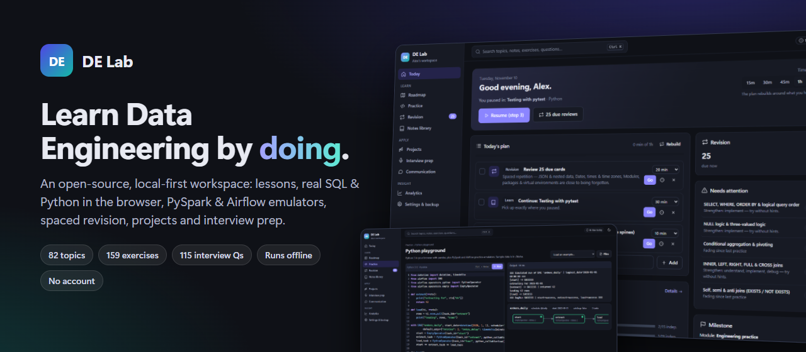
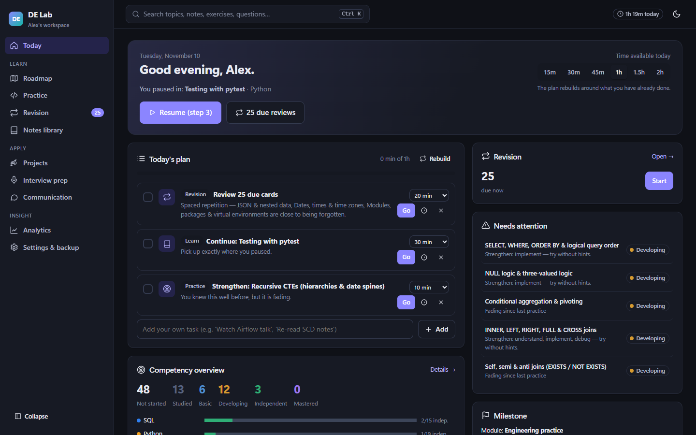
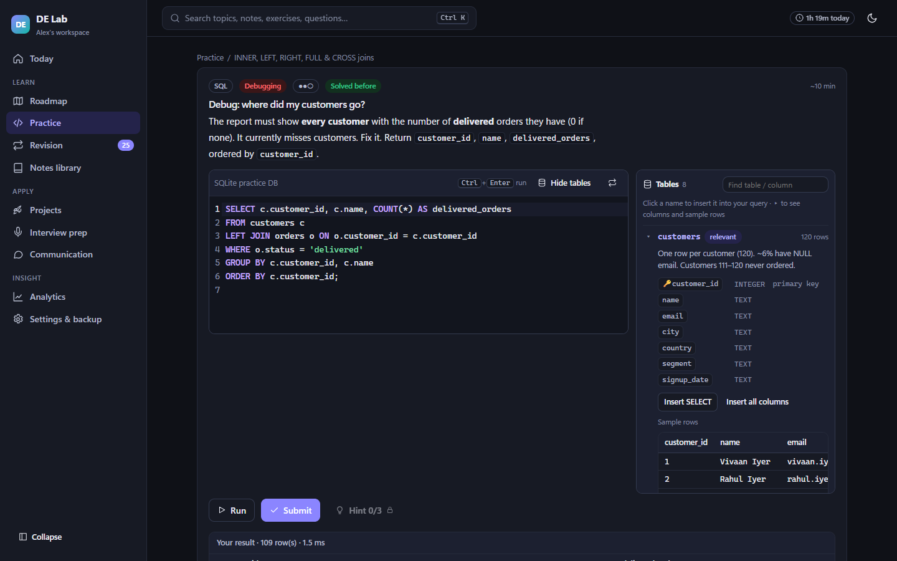
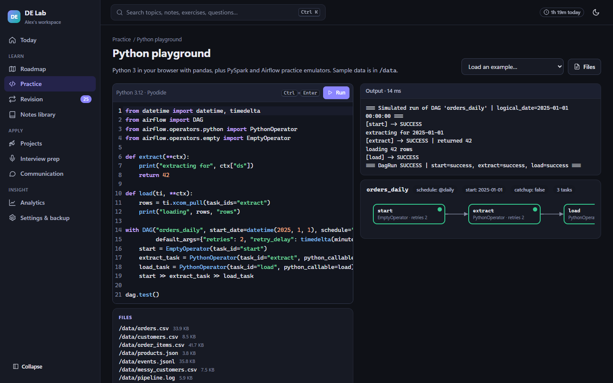
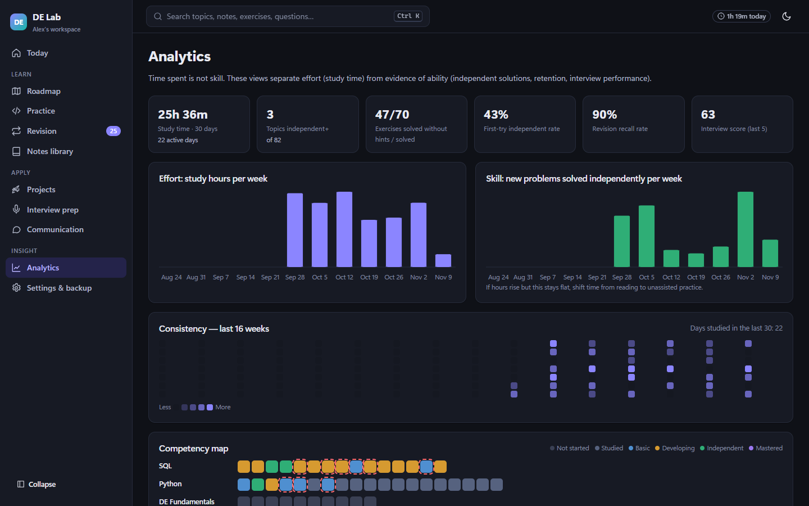
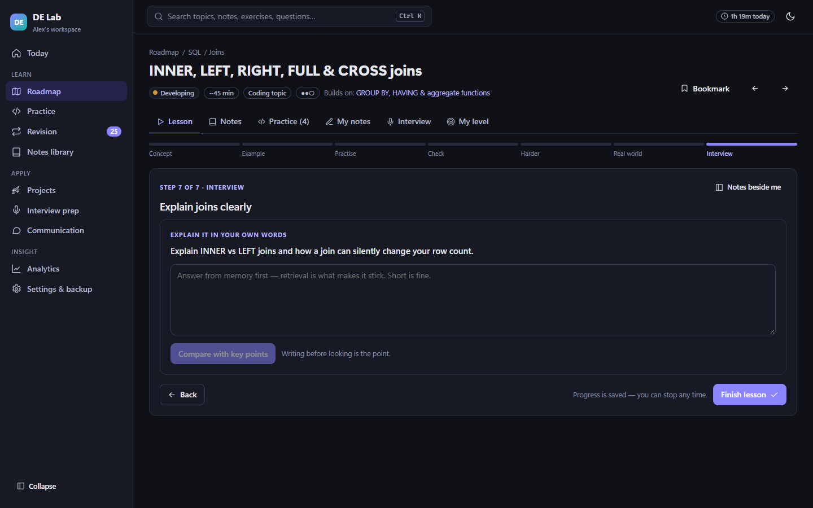
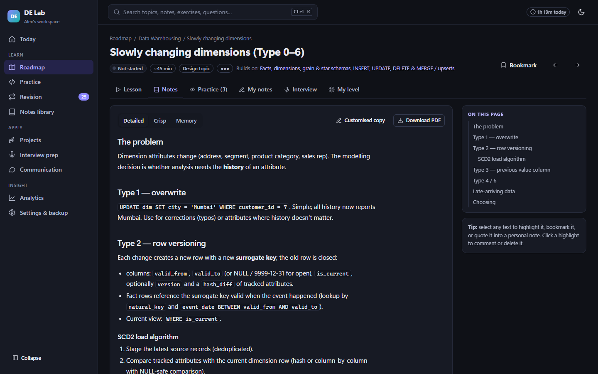
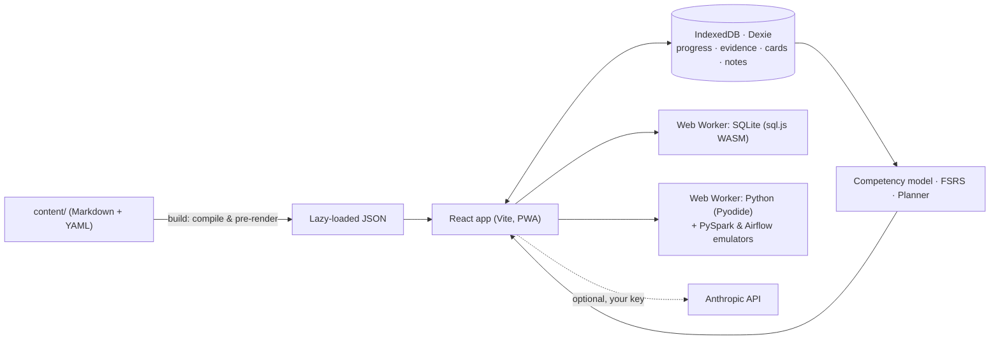

<div align="center">



# DE Lab

### The open-source workspace for learning Data Engineering — by actually doing it.

Lessons · real SQL & Python in your browser · PySpark & Airflow emulators · spaced revision · projects · interview prep<br>
**No account. No server. No tracking. Works offline.**

[](https://deepit20.github.io/de-lab/?demo=1)
[](https://github.com/deepit20/de-lab/releases/latest)

[](https://github.com/deepit20/de-lab/actions/workflows/ci.yml)
[](LICENSE)
[](CONTRIBUTING.md)
[](https://github.com/deepit20/de-lab/stargazers)

**[Live demo](https://deepit20.github.io/de-lab/?demo=1)** · **[Features](#-features)** · **[Quick start](#-quick-start)** · **[Curriculum](#-curriculum)** · **[Contribute](#-contributing)**

</div>

---

> **Courses teach you *about* data engineering. DE Lab makes you *do* it** — write the query, debug the pipeline, schedule the DAG, explain the trade-off — and only marks a skill as yours when you've proven it without hints, more than once.

If DE Lab helps you learn, please **⭐ star the repo** — it's the best way to help other learners find it.

## ✨ Why DE Lab?

| 🎯 **Skill, not completion** | 🧪 **Real practice, zero setup** | 🧠 **Remember what you learn** |
|---|---|---|
| Topics move *Studied → Basic → Developing → Independent → Mastered* only on evidence: hint-free solutions, debugging, explanations, scenarios — retained over time. | SQL on a realistic e-commerce database, Python via WebAssembly, **PySpark & Airflow emulators** that run real code — all inside the browser. | FSRS spaced repetition driven by *how* you answered (hints, mistakes, speed). Your mistakes become review cards. |
| **📅 A plan that fits your day** | **🎤 Interview-ready** | **🔒 Private by design** |
| Say how much time you have; get a balanced plan. Missed a week? No guilt wall of 400 reviews — the most at-risk items come first. | 115 questions, timed coding rounds, realistic mock interviews, scenario rounds ("the pipeline failed at 3 a.m…"), project defence and job-description analysis. | Local-first: your data stays in your browser. No sign-up, no analytics, no ads. Optional AI coach uses *your* key, client-side. |

## 📸 Features

<table>
<tr>
<td width="50%"><br><b>Today</b> — an adaptive plan for the time you have, what's fading, what's next.</td>
<td width="50%"><br><b>SQL practice</b> — tables panel with columns, types &amp; sample rows; click to insert; grading with feedback and query plans.</td>
</tr>
<tr>
<td><br><b>Airflow & PySpark emulators</b> — write real DAG / DataFrame code, see the graph, simulate retries and trigger rules.</td>
<td><br><b>Analytics</b> — effort vs. skill: study hours next to problems solved <i>independently</i>.</td>
</tr>
<tr>
<td><br><b>Lessons</b> — concept → example → practise → check → harder → real world → interview.</td>
<td><br><b>Notes</b> — detailed, crisp &amp; memory notes, highlights, personal notes, cheat sheets, <b>PDF export</b>.</td>
</tr>
</table>

<details>
<summary><b>Everything that's included</b></summary>

- **Roadmap** — 10 tracks, 82 topics with prerequisites; respects what you already know (claimed knowledge is verified by short checks).
- **159 exercises** — coding, debugging, scenarios, predict-the-output; hidden edge-case tests; traceback explanations; engineering review (SQL anti-patterns, Python code smells); hints unlock only after you try. Every reference solution is executed in CI.
- **Revision** — scheduled, weak-area, mistake-based, topic-wise and quick-recall sessions (FSRS).
- **Notes library** — highlights, bookmarks, personal notes with version history, doubts, a mistake journal, printable cheat sheets, PDF export.
- **6 projects** — guided → independent → production-style, with milestones, a code workspace, design doc, work log, self-review rubric and project-defence questions.
- **Interview prep** — question bank, mock & timed rounds, scenarios, project defence, JD analysis, history.
- **Communication** — explain-a-concept practice with clarity scoring, answer frameworks (STAR, PREP…), English exercises.
- **Your data, safe** — JSON backup/restore and automatic daily backups to a folder (e.g. OneDrive).
- **Optional AI coach** — adaptive interview follow-ups, rubric feedback, Socratic hints (bring your own Anthropic API key).
</details>

## 🚀 Quick start

| Option | How | Best for |
|---|---|---|
| **Try it** | Open the **[live demo](https://deepit20.github.io/de-lab/?demo=1)** (sample progress) or **[start fresh](https://deepit20.github.io/de-lab/)** — install it from the address bar to use offline. | Everyone |
| **Windows, no install** | Download `DE-Lab.zip` from **[Releases](https://github.com/deepit20/de-lab/releases/latest)** → Extract → double-click `Start DE Lab.bat`. | Learners on Windows |
| **From source** | `git clone … && cd de-lab && npm install && npm run dev` → http://localhost:5178 | Contributors |

Setup asks only your name — everything else is optional and skippable.

## 📚 Curriculum

| # | Track | Topics | Exercises | What you'll be able to do |
|---|---|:-:|:-:|---|
| 1 | **SQL** | 15 | 46 | joins without fan-out, window functions, MERGE/upserts, gaps & islands, query plans |
| 2 | **Python** | 19 | 40 | clean data, files & JSON, generators, APIs with retries & watermarks, pandas, tests |
| 3 | **DE Fundamentals** | 10 | 19 | OLTP vs OLAP, file formats, lakes & lakehouses, batch vs streaming, data quality, idempotency |
| 4 | **Data Warehousing** | 6 | 7 | facts & dimensions, grain, SCD Type 2, medallion layers |
| 5 | **BigQuery & GCP** | 7 | 10 | architecture, partitioning & clustering, cost control, nested data |
| 6 | **ETL / ELT** | 7 | 8 | load strategies, incremental loads, CDC, validation, recovery, dbt |
| 7 | **Apache Airflow** | 7 | 11 | DAGs, data intervals & backfills, XCom/TaskFlow, branching, production practices |
| 8 | **PySpark** | 8 | 14 | architecture, DataFrames, joins & windows, partitions & shuffles, tuning |
| 9 | **Projects** | 6 projects | — | end-to-end builds you can defend in interviews |
| 10 | **Interviews** | 3 + 115 Qs | 4 | strategy, pipeline system design, project stories |

## 🏗️ How it works



- **Vite + React + TypeScript**, ~120 KB gzipped initial load, offline via service worker.
- **Content as code** — every lesson is a Markdown file; every exercise's reference solution is executed in CI (`npm run validate`).
- Core logic lives in `src/lib/`: `competency.ts` (evidence → levels), `fsrs.ts` (scheduling), `planner.ts` (daily plan), `record.ts` (all learning events).

## 🗺️ Roadmap

- [x] 10-track curriculum, 159 validated exercises, emulators, revision, projects, interviews
- [ ] Step-by-step lessons for the remaining 39 "essential" topics — **[great first contribution](CONTRIBUTING.md)**
- [ ] DuckDB engine for BigQuery-style SQL (`STRUCT`, `UNNEST`, `QUALIFY`)
- [ ] dbt-style modelling playground
- [ ] Kafka / streaming simulator
- [ ] Translations of the interface and notes
- [ ] Shareable progress cards & optional encrypted sync

Have an idea? [Open an issue](https://github.com/deepit20/de-lab/issues/new/choose) or start a discussion.

## 🤝 Contributing

Content is the heart of DE Lab — a new lesson, a tricky exercise or a correction helps every learner. See **[CONTRIBUTING.md](CONTRIBUTING.md)** (lessons are just Markdown) and look for issues labelled **`good first issue`** and **`content`**.

```bash
npm install && npm run dev     # edit content/ — the app reloads
npm run validate               # runs every exercise solution
```

## ❓ FAQ

<details><summary><b>Is it really free? What's the catch?</b></summary>MIT-licensed, no ads, no accounts, no telemetry. The only optional paid thing is the AI coach, which uses <i>your own</i> Anthropic API key.</details>
<details><summary><b>Where is my data stored?</b></summary>In your browser's IndexedDB on your device. Use Settings → Backup to export it or enable daily backups to a folder.</details>
<details><summary><b>Does PySpark / Airflow really run in the browser?</b></summary>Your code runs against faithful <b>teaching emulators</b> of the common APIs — great for syntax and reasoning (lazy evaluation, plans, DAG structure, retries, trigger rules). Cluster and scheduler internals are explained and simulated, not executed.</details>
<details><summary><b>I already know SQL. Do I have to start from zero?</b></summary>No. Mark what you know during setup; short verification checks confirm it, and the planner moves you on.</details>

## ⭐ Support the project

If DE Lab helped you learn something, land an interview or a job:
- **Star the repo** so more learners discover it
- Share it with someone learning data engineering
- Contribute a lesson or exercise

[](https://star-history.com/#deepit20/de-lab&Date)

## 📄 License

[MIT](LICENSE). Third-party components keep their own licenses: React, Dexie, CodeMirror, sql.js, marked, MiniSearch (MIT); Pyodide (MPL-2.0, loaded from jsDelivr at runtime).

<div align="center"><sub>Built with ❤️ for everyone teaching themselves data engineering.</sub></div>
